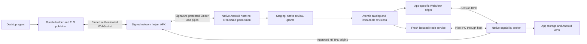

# Android-first implementation plan

Source: [issue #1: Initial Target](https://github.com/getnamo/PocketSubstrate/issues/1). Updated for the M0–M4 implementation on 2026-10-18. Upstream started as README, LICENSE, and .gitignore; runtime, tooling, and tests were added in this first pass.

## Objective and scope

Let a user receive an agent-created app on their phone, inspect its code and requested native capabilities, grant selected access, and iterate live. The user confirmed a native Android substrate, embedded Node.js plus web sub-apps, and desktop-agent delivery over local Wi-Fi. Embedded Node is required from the first milestone. Unreal, phone-driven prompting, and local models are outside M0–M4.

The first pass targets sideloading, Android 10/API 29 or later, one active foreground app, pure-JS dependencies bundled on desktop, and permission-mediated storage, haptics, motion, approximate location, and HTTPS. The pinned experimental runtime currently requires 4 KiB memory pages. Production and 16 KiB support remain explicit follow-up gates.

## Implemented architecture

The host uses Kotlin/Compose, AndroidX WebKit, coroutines, an AtomicFile JSON catalog, and a small JNI Node adapter. Catalog/state size is bounded; Room/DataStore can replace this storage if complexity grows. The publisher is a Node CLI with an esbuild bundler; the SDK has TypeScript declarations and runtime adapters for both JS environments.

### Isolation decisions established during implementation

- Node starts in an Android isolated service, with no host permissions, a fresh UID/process per session, pipe-based messages, blocked program execution, and native addon loading disabled. Backend code is delivered as source; it cannot read the host bundle directory or private files. Direct socket attempts fail independently of SDK checks.
- WebView request interception, network-load settings, and CSP did **not** stop WebRTC UDP in the initial prototype. The strengthened design removes INTERNET permission from the host entirely. A second, same-signed APK handles connections and HTTPS through a signature-protected Binder service. Sub-app JS never runs in that helper.
- Each app has its own synthetic HTTPS origin and constrained asset handler. The bridge validates main frame and origin, and derives app identity from native session state. The host blocks direct browser network/media grants, navigation, file/content URLs, frames, workers, cookies, and DOM storage. SDK storage is the durable-state contract.
- Per-call policy is the intersection of declaration, granted scope, global bans, Android permissions, and lifecycle. Grant changes close subscriptions and replace the runtime. Network redirects are revalidated against exact HTTPS origins; responses and requests are bounded.

The pinned nodejs-mobile 18.20.4 archive is checksummed, with license notices packaged into the APK. Its Node baseline is obsolete and its ELF alignment is 4 KiB. A maintained build, 16 KiB compatibility, security review, and physical-device validation are prerequisites for broader distribution; these are not claims established by this prototype.

### Revision and publishing behavior

The desktop bundles frontend assets and pure-JS CommonJS backend dependencies into a `.psub` JSON envelope. SHA-256 identifies its payload. Staging validates size, paths, schema, entries, hash, and source ownership before adding a pending revision. Native UI exposes files, capability reasons, grants, global bans, app deletion, and rollback.

Pairing uses a single-use five-minute secret and an out-of-band TLS certificate fingerprint. The resulting credential authenticates the WebSocket. The phone initiates connections; the publisher cannot grant permissions. New apps and expanded scopes wait for review. A user-enabled live session reloads only the running app within its existing grants. The publisher resends its latest bundle on reconnect; duplicate active/pending content is harmless. There is no remote activate command.

Activation stops both old runtimes, writes a recovery marker with the new active revision, and starts fresh sessions. Node and frontend readiness confirm activation. Failed or interrupted startup restores the previous revision pointer, leaves the failed candidate reviewable, and presents a native error; the user can relaunch the previous app. Post-start failure retains native recovery/rollback controls. Saved data survives code updates and rollback; rollback does not undo data mutations.

Delivery runs in the foreground. Backgrounding closes runtimes and the connection; resume restarts the selected app without automatically restoring live-edit mode. Recreating the activity returns to the launcher with catalog/data preserved. Ready notifications open review, and a ready queue remains usable if notification permission is denied. Diagnostics sharing is off by default.

## Milestones and status

| Milestone | Delivered | Remaining acceptance |
| --- | --- | --- |
| M0: runtime | Compose shell, embedded isolated Node/JNI, WebView, real backend RPC, storage/haptics, network isolation probes, process replacement | Physical arm64 validation and runtime performance/memory baseline |
| M1: app lifecycle | Validated imports, immutable revisions, atomic catalog/recovery, native review/launcher, deletion, error/rollback controls | Broader malformed input/fault-injection coverage |
| M2: capabilities | Shared permission broker, grant/revoke, global bans, motion, HTTPS helper, foreground approximate location | Physical sensor/haptic/GPS behavior, OS permission revocation matrix, network cancellation/redirect integration matrix |
| M3: publishing | CLI, pinned TLS pairing, authenticated push/reconnect, explicit live edit, scope review, rollback, optional diagnostics | Physical Wi-Fi latency/reconnection and sustained reload stress |
| M4: first-pass polish | Ready queue/notifications, touch game, field notes, lifecycle handling, setup and authoring contract | Full physical-phone demo, notification/QR UX matrix, independent authoring exercise |
| M5: phone-driven generation | Planned: prompt UI, remote-agent adapter, job status/cancel through the existing protocol | User creates/refines an app from the phone |
| M6: local agent | Planned: llama.cpp, model management, tool loop, cancellation, resource limits | Offline agent produces a reviewed revision on target hardware |

M0–M4 implementation is present. Their complete acceptance, especially M4's physical-phone gate, is **not yet established**. See [validation status](validation.md) for actual test evidence. M4 does not complete the entire originating issue.

## Physical demo acceptance checklist

- Install both same-signed APKs on a supported arm64 phone. Pair over Wi-Fi, receive a new game, inspect files, grant selected capabilities, and launch real Node logic.
- Edit backend scoring and frontend presentation without reinstalling APKs. Measure validation-to-ready latency; the working target is under two seconds for small changes, not a guarantee for generation or network time.
- Deny a capability, grant it to one app only, then revoke it and apply a global ban. Confirm errors, OS permission behavior, and stopped subscriptions in both runtimes.
- Add location to a live revision and confirm it waits for review. Exercise approximate-location grant/deny, sensor start/stop, haptic feedback, and destination-scoped HTTPS including redirects and cancellation.
- Interrupt transfer and activation; try invalid bundles, frontend failure, Node crash/hang, and renderer exit. Confirm native close/rollback remain reachable and the previous app can run with saved data.
- Test background/resume, activity recreation, process death, offline launch, publisher restart, denied notifications, notification review links, QR pairing, and unpairing.
- Delete an app and confirm its revisions, grants, and supported persistent data are removed. Have another agent create a sub-app using only the [authoring contract](agent-authoring.md).

## Production follow-up

Build a maintained Node runtime with 16 KiB-compatible ELF alignment; verify both ABIs and third-party notices. Perform an independent security review of the two-APK/Binder/renderer boundaries, resource exhaustion limits, publisher credential lifecycle, and hostile input parsing. Add state migrations/snapshots before destructive data upgrades, bounded stress/performance measurements, release signing and distribution policy, and an OEM/device matrix. Do not weaken isolation or drop Node to bypass these gates.
